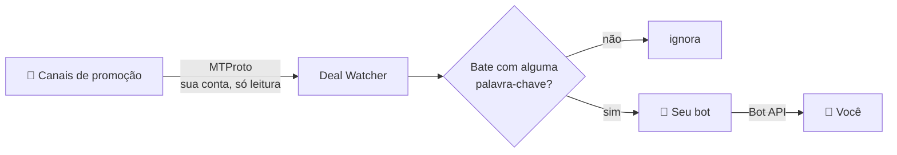

# 🔔 Telegram Deal Watcher

Monitora os canais de promoção que você segue no Telegram e te avisa **só** quando aparece algo que você quer.

Silencie todos os canais de ofertas e receba apenas o que bate com as suas palavras-chave, como `nintendo switch 2`, `odyssey g5 27` ou `macbook`.


---

## Como funciona



- **Leitura com a sua conta:** o script se conecta como um cliente do Telegram (via [GramJS](https://gram.js.org)), porque um bot comum não consegue ler canais dos quais não é admin. Ele é **somente leitura**: não envia mensagens com a sua conta nem entra em canais sozinho.
- **Aviso por um bot:** o Telegram não notifica mensagens enviadas pela própria conta. Por isso, quem envia o alerta é um bot seu, e o celular toca.

Exemplo de aviso:

```
🔔 nintendo switch 2
📢 ofertasnintendobr

Console Nintendo Switch 2 + Mario Kart World por R$ 3.499 ...

https://t.me/ofertasnintendobr/12345
```

## Funcionalidades

- 🔎 **Filtro inteligente:** ignora maiúsculas e acentos, exige todos os termos em qualquer ordem, compara palavras inteiras (`27` não bate com `270Hz`) e aceita termos de exclusão.
- 📡 **Todos os canais ou só alguns:** use `"all"` para monitorar todos os canais que você segue (os que você seguir depois entram sozinhos) ou informe uma lista.
- 🚫 **Sem avisos repetidos** da mesma mensagem.
- 🔁 **Resiliente:** reconecta sozinho quando a conexão cai, respeita os limites de requisição do Telegram e tenta de novo quando a rede falha.
- ✅ **Configuração validada na inicialização**, com mensagens de erro claras.

## Pré-requisitos

- Node.js 24+
- Uma conta do Telegram
- Docker (opcional, para rodar em servidor)

## Configuração

### 1. Instale as dependências

```bash
npm install
```

### 2. Pegue as credenciais

| Variável | Onde conseguir |
|---|---|
| `API_ID` e `API_HASH` | [my.telegram.org](https://my.telegram.org) → *API development tools* → crie um app (plataforma: Desktop) |
| `BOT_TOKEN` | Fale com o [@BotFather](https://t.me/BotFather) e envie `/newbot` |
| `NOTIFY_CHAT_ID` | Seu id: fale com o [@userinfobot](https://t.me/userinfobot) |

> [!IMPORTANT]
> Abra o seu bot e envie **`/start`**. Um bot não pode iniciar conversa com ninguém, e sem isso ele não consegue te mandar os avisos.

```bash
cp .env.example .env
# preencha API_ID, API_HASH, BOT_TOKEN e NOTIFY_CHAT_ID
```

### 3. Faça login com a sua conta (uma vez só)

```bash
npm run login
```

Informe o telefone (com `+55`), o código que chega no app do Telegram e a senha de duas etapas, se tiver. No final aparece uma linha `TELEGRAM_SESSION=...`: cole essa linha no `.env`.

> [!CAUTION]
> A `TELEGRAM_SESSION` dá **acesso total à sua conta**. Nunca faça commit dela nem compartilhe. Se vazar, encerre a sessão em *Configurações → Dispositivos* no Telegram.

### 4. Escolha canais e palavras-chave

Edite o `keywords.json`:

```json
{
  "channels": "all",
  "ignoreChannels": ["algum_canal_de_noticias"],
  "keywords": [
    { "terms": "nintendo switch 2", "exclude": ["oled", "lite"] },
    { "terms": "odyssey g5 27", "exclude": ["32", "oled"] },
    { "terms": "macbook", "exclude": ["capa", "pelicula"] }
  ]
}
```

| Campo | Significado |
|---|---|
| `channels` | `"all"` para todos os canais que você segue, ou uma lista como `["pelando", "@outro_canal"]` |
| `ignoreChannels` | Canais a pular no modo `"all"` (opcional) |
| `terms` | Todas as palavras precisam aparecer na mensagem, em qualquer ordem |
| `exclude` | Se qualquer uma aparecer, a mensagem é descartada (opcional) |

> [!TIP]
> O username de um canal é o que vem depois de `t.me/` no link dele. Mudou o `keywords.json`? Reinicie o programa para aplicar.

## Rodando

### Localmente

```bash
npm run dev
```

Se estiver tudo certo, você recebe **"✅ Monitor de promoções iniciado."** no Telegram.

### Com Docker

```bash
docker build -t telegram-deal-watcher .
docker run -d --name telegram-deal-watcher --restart unless-stopped \
  --env-file .env \
  --log-opt max-size=10m --log-opt max-file=3 \
  telegram-deal-watcher

docker logs -f telegram-deal-watcher
```

> [!WARNING]
> - No `.env` usado pelo Docker, escreva os valores **sem aspas**.
> - **Não rode duas instâncias ao mesmo tempo** com a mesma sessão (por exemplo, no seu PC e no servidor). O Telegram pode revogar a sessão.

### No Google Cloud (grátis ou quase)

Uma VM `e2-micro` do nível *Always Free* dá e sobra:

- Região `us-west1`, `us-central1` ou `us-east1`
- Disco **Standard persistent disk** de até 30 GB (o "Balanced", padrão do console, é cobrado)
- O IPv4 externo em uso pode gerar uma cobrança pequena. Configure um alerta de orçamento.

Instale o Docker na VM, copie o projeto e o `.env`, e use os comandos da seção anterior.

## Scripts

| Comando | O que faz |
|---|---|
| `npm run dev` | Roda em desenvolvimento, reiniciando ao salvar arquivos `.ts` |
| `npm run login` | Login interativo para gerar a `TELEGRAM_SESSION` |
| `npm run build` | Compila para `dist/` |
| `npm start` | Roda a versão compilada |
| `npm test` | Roda os testes |
| `npm run typecheck` | Verifica os tipos |
| `npm run check` | Typecheck e testes |

## Arquitetura

Arquitetura hexagonal leve (*ports & adapters*): a regra de negócio não sabe que o Telegram existe.

```
src/
├── domain/                  regras puras, sem dependências
│   ├── offer.ts               o que é uma oferta
│   └── keyword-filter.ts      a oferta bate com alguma palavra-chave?
├── application/
│   ├── ports.ts               interfaces OfferSource, Notifier e Logger
│   └── watch-offers.ts        caso de uso: recebe → filtra → evita duplicata → avisa
├── infrastructure/          a única parte que conhece GramJS e Bot API
│   ├── config.ts              lê e valida .env e keywords.json (zod)
│   ├── telegram-client.ts     cria e conecta o cliente MTProto
│   ├── telegram-source.ts     adaptador de entrada: escuta os canais
│   └── telegram-notifier.ts   adaptador de saída: envia o aviso pelo bot
├── login.ts                 script de login
└── main.ts                  liga tudo
```

Graças aos ports, o caso de uso é testado com fakes, sem Telegram e sem internet.

**Stack:** Node.js 24 · TypeScript (strict, sem `any`) · [GramJS](https://gram.js.org) · [zod](https://zod.dev) · [Vitest](https://vitest.dev) · Docker

## Limitações conhecidas

- Mensagens postadas enquanto o programa está fora do ar (computador suspenso, reinício, deploy) **não são recuperadas**.
- Mensagens **editadas** não são reavaliadas: só posts novos contam.
- Mensagens só com imagem, sem legenda, são ignoradas.
- O histórico de avisos fica em memória e é zerado ao reiniciar.

## Aviso

Projeto pessoal e educacional. Ele usa a sua conta só para **leitura**, dentro dos [termos da API do Telegram](https://core.telegram.org/api/terms). Não o adapte para enviar mensagens em massa nem para automatizar ações na sua conta.
